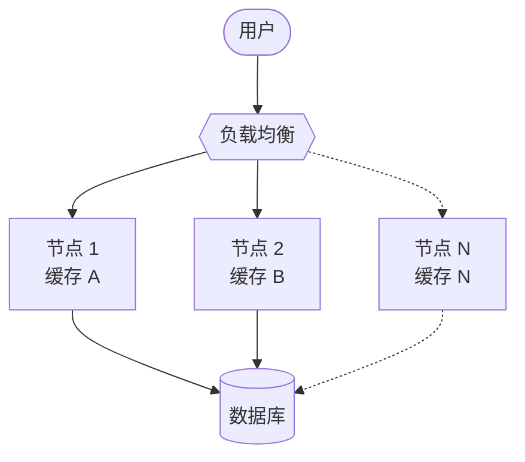
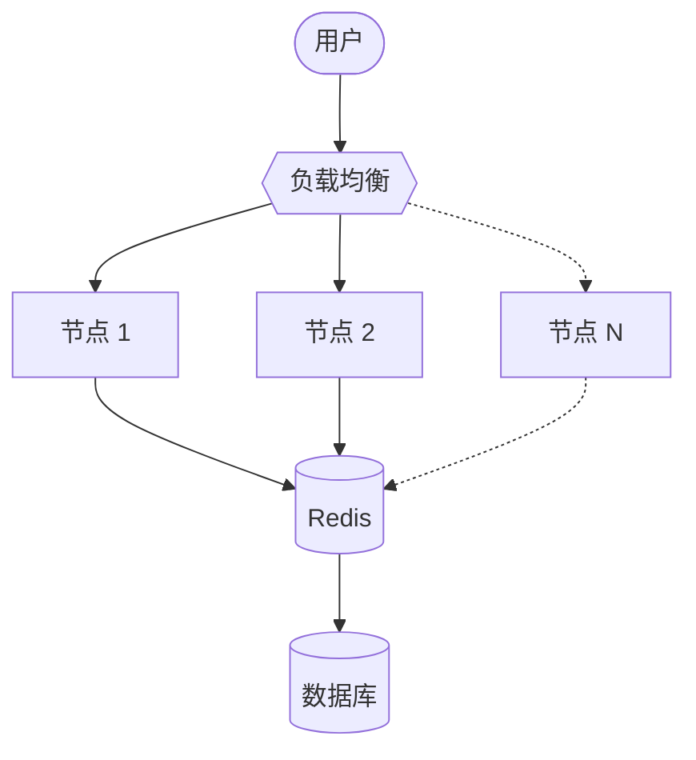
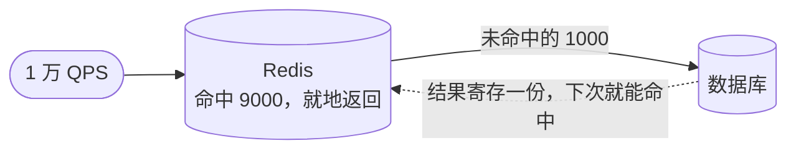

最近几个月有意无意地在做一些全栈方面的转型尝试。首先是公司内的业务变动，让我有了更多机会去参与后端开发；其次在 AI 时代下，模型能帮助我们在更多不熟悉的领域进行编码。在这个过程中，积累了一些在之前纯前端开发过程中不曾思考过的东西，这里记录下来，以供学习参考。首先用 Redis 来打头吧。

## 状态共享

我对 Redis 最初的印象就是一个负责 KV 缓存的应用，感觉有没有都一样：缓存我为什么要使用 Redis，而不是使用 Node.js 里面的对象的 KV 呢？后者既可以避免进程间通信带来的延迟，还可以实现得非常简单，实在没有看出来 Redis 的必要性。

实际上也确实是这样，二者性能差距是非常明显的，而且是数量级上的差距。使用 JavaScript Map 访问远远快于访问 Redis。我在自己的电脑上实测了一组数据，可以看到即使使用 pipeline 把网络往返摊薄之后，仍然比 Map 慢几百倍。

| 访问方式                          | 单次耗时     | 每秒操作数  |
| --------------------------------- | ------------ | ----------- |
| JS Map（进程内）                  | 约 20 纳秒   | 4000 万以上 |
| Redis 逐条读写                    | 约 0.25 毫秒 | 约 4000     |
| Redis pipeline（一次打包 100 条） | 约 10 微秒   | 约 10 万    |

但是，应用的实际部署方式决定了我们有时候并不能使用进程内的 Map 来做 KV 存储。比方说，我们有一个应用，它可能部署在了 10 个节点里。这时候，用户的每个请求都可能会被打到不同的节点，而每个节点维护着各自的缓存实例，这些请求就很有可能享受不到先前请求创建的缓存。

而一个独立于这些节点之外的 Redis 服务就能够很好地处理这个问题。所有的缓存都是维护在这个 Redis 服务上的，大家对缓存数据来源也就有了一个共识

## 职责分离

假设说我们部署的应用是在一个节点上，不用考虑状态共享的问题，也是可能需要使用 Redis 的。

首先就是内存归属。倘若使用进程内的 Map 来做大量的缓存，我们会极大地增加该进程的内存压力。这个过程可能会做频繁的垃圾回收，从而影响应用的性能。

其次就是 Redis 提供了很多高级功能，比方说 TTL，还有原子计数、Set When Not Exists 等等。这些我们当然可以使用 Node.js 实现，但是为什么要重复造轮子呢？专业的事情还是交给专业的工具去做比较好，可维护性优先！

## 数据库压力分流

性能只是这里面相对次要的收益，最主要的收益就是降低数据库的压力，这比降低查询延迟更重要。数据库作为整个应用的唯一事实来源，是绝对不能轻易挂掉的。

假设说我们应用有 1 万 QPS，如果不加缓存，这 1 万 QPS 的请求都会打到数据库上，就会让数据库压力剧增，进而有可能导致服务不可用的现象。

假设我们加入一个 Redis 服务，哪怕这时候只有 9000 次命中缓存，数据库就只会承受 1000 QPS 的压力。Redis 的内存操作比数据库的文件读写操作代价要低廉很多，这颇有一种学习计算机网络时，在网络中加入缓存服务器，降低出口流量的味道了。

而且数据库做拓展比 Redis 要困难很多，因为数据库需要维护索引、事务，还有主从复制等问题。这对于初涉后端的我来说，实在是超纲了🤣
